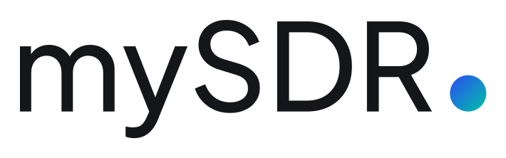

<p align="center"></p>

# mySDR plugin for Cursor and Grok Bot

[mySDR](https://mysdr.app) is the GTM layer for AI agents. Your assistant does the sales work; mySDR gives it the data, signals and outreach channels to do it:

- **Find people and companies**: search by role, company, region and technology; enrich with full profiles, work emails and phone numbers.
- **Signals**: watch for reasons to reach out now and keep your Leads and Companies tables up to date.
- **Outreach**: build flows, draft messages in your own voice, and run LinkedIn and email sequences, with a check before anything is sent.
- **Follow-up**: read replies and LinkedIn conversations, keep an agenda, dashboards and an outcome review.

This plugin connects your assistant to the hosted mySDR MCP server at `https://mysdr.app/api/mcp` and adds two skills that walk you through setup and your first engine. It contains no code and no secrets.

## Install (one click)

**Cursor marketplace:** open the mySDR plugin in the Cursor marketplace and click **Install**. (Listing pending review.)

**Cursor, direct link:**
[Add mySDR to Cursor](https://cursor.com/install-mcp?name=mysdr&config=eyJ1cmwiOiJodHRwczovL215c2RyLmFwcC9hcGkvbWNwIn0%3D) (opens Cursor via `cursor://anysphere.cursor-deeplink/mcp/install`)

**Manual:** add this to your MCP config (`~/.cursor/mcp.json` or any client that supports remote MCP servers):

```json
{
  "mcpServers": {
    "mysdr": { "url": "https://mysdr.app/api/mcp" }
  }
}
```

**Claude:** Settings → Connectors → Add custom connector → paste `https://mysdr.app/api/mcp`.

## Sign in (OAuth, no API key)

1. After install, your assistant shows mySDR as *needs login*. Click **Connect**.
2. Your browser opens mysdr.app. Sign in (or create a free account).
3. Click **Allow**. You return to your assistant and the mySDR tools are ready.

Under the hood this is standard MCP authorization: OAuth 2.1 with PKCE (S256), dynamic client registration, and discovery via `/.well-known/oauth-protected-resource`. Access tokens last one hour and refresh automatically. You can revoke access at any time in mySDR. API keys still work as a fallback for clients without OAuth; see the [docs](https://mysdr.app/docs/getting-started/agents-and-keys).

## Skills in this plugin

| Skill | What it does |
| --- | --- |
| `mysdr-onboarding` | Reads your onboarding status, fills in what is missing (website, sender details) and shows your credit balance. |
| `mysdr-first-engine` | Takes you from a target segment to a first reviewed outreach, asking before it spends credits or sends anything. |

## Tools overview

The server exposes around 70 tools. Every tool has a title and read-only or destructive annotations, so your assistant asks before it changes or sends anything. The main groups:

| Group | Examples |
| --- | --- |
| Find and enrich | `search_people`, `enrich_people`, `find_phones`, `reverse_email_lookup`, `find_companies_using_technology`, `get_tech_stack` |
| Tables | `list_table`, `get_table_row`, `save_leads`, `save_companies`, `update_row`, `remove_saved` |
| Signals and leads | `list_leads`, `get_lead_context`, `list_agent_signals`, `save_agent_signal` |
| Outreach | `list_flows`, `save_flow`, `start_flow`, `start_linkedin_sequence`, `check_before_sending`, `get_outreach_status` |
| Conversations | `get_replies`, `list_linkedin_conversations`, `send_reply`, `send_linkedin_message` |
| Planning and insight | `get_agenda`, `list_human_tasks`, `list_dashboards`, `get_outcome_review`, `get_usage` |
| Setup | `get_onboarding_context`, `get_writing_context`, `get_outreach_playbook`, `save_gtm_brain` |

Tools marked "(spends credits)" use mySDR credits; `get_usage` shows your balance.

## Links

- Website: https://mysdr.app
- Docs: https://mysdr.app/docs
- Privacy policy: https://mysdr.app/en/privacy
- Terms: https://mysdr.app/en/terms
- Support: support@mysdr.app

## License

MIT © 2026 LVDP CommV. See [LICENSE](LICENSE). mySDR and the mySDR logo are trademarks of LVDP CommV.
